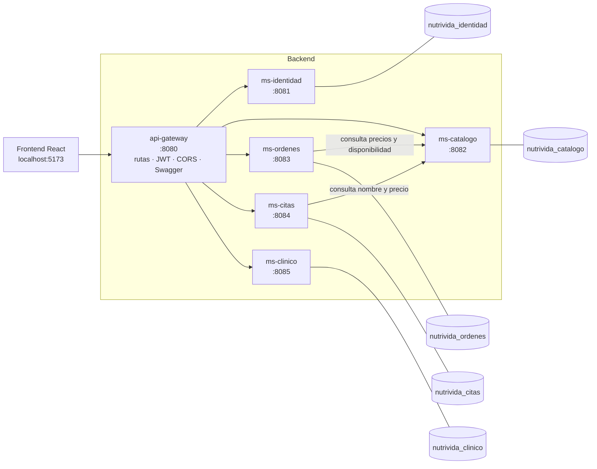

# NutriVida – Backend (microservicios)

Backend de **NutriVida**, plataforma de atención nutricional, desarrollado para la Evaluación Parcial 3 de **Desarrollo Fullstack II (DSY1104)**.

Arquitectura de **microservicios con Spring Boot**, autenticación con **JWT** (token de acceso + token de renovación), permisos por rol, documentación con **Swagger/OpenAPI** y rutas versionadas (`/api/v1`).

> Frontend del proyecto: [Anys-VS/NutriVida-React](https://github.com/Anys-VS/NutriVida-React)

---

## Arquitectura



| Servicio | Puerto | Base de datos | Responsabilidad |
|---|---|---|---|
| **api-gateway** | 8080 | — | Punto de entrada único. Enruta, valida el JWT (1ª capa de seguridad), centraliza CORS y une la documentación Swagger. |
| **ms-identidad** | 8081 | `nutrivida_identidad` | Registro de pacientes, login, emisión y renovación de JWT, cierre de sesión y CRUD de usuarios. |
| **ms-catalogo** | 8082 | `nutrivida_catalogo` | CRUD de categorías y servicios (consultas, planes, evaluaciones y talleres), precios con descuento y cupos. |
| **ms-ordenes** | 8083 | `nutrivida_ordenes` | Carrito de atenciones, pago simulado y órdenes. Se comunica con ms-catalogo por HTTP. |
| **ms-citas** | 8084 | `nutrivida_citas` | Nutricionistas con su jornada y citas: cada rol ve solo lo suyo. Consulta precios en ms-catalogo. |
| **ms-clinico** | 8085 | `nutrivida_clinico` | Fichas clínicas: mediciones, IMC, progreso y plan alimenticio. Solo el paciente y su nutricionista. |

**Seguridad en dos capas:** el gateway rechaza las peticiones sin token o con un token inválido o vencido. Cada microservicio vuelve a validar el token y aplica los permisos por rol (`@PreAuthorize`).

**Llamadas entre servicios:** cuando ms-ordenes necesita agendar en ms-citas lo que se pagó, no reenvía el token del paciente: firma su propio token de servicio (1 minuto, rol `SERVICIO`, que ningún usuario puede tener). Ese endpoint solo acepta ese rol o al administrador, y el gateway lo bloquea desde el navegador.

---

## Tecnologías

- Java 21 · Spring Boot 4.0.9 · Maven
- Spring Web MVC · Spring Data JPA (Hibernate 7) · Bean Validation
- Spring Security 7 + OAuth2 Resource Server (JWT HS256) · BCrypt
- Spring Cloud Gateway (WebFlux)
- springdoc-openapi 3.0.3 (Swagger UI)
- MySQL 8.4
- JUnit 5/6 · Mockito · AssertJ

---

## Requisitos

| Herramienta | Versión |
|---|---|
| JDK | 21 (Eclipse Temurin) |
| MySQL Server | 8.4 LTS, corriendo en `localhost:3306` |
| IDE | IntelliJ IDEA (recomendado; trae Maven integrado) |

Las bases de datos **se crean solas** al iniciar cada servicio (`createDatabaseIfNotExist=true`), y los datos de prueba se cargan automáticamente la primera vez.

---

## Configuración: variables de entorno

Las credenciales **no están en el código**. Cada servicio las lee desde variables de entorno:

| Variable | Obligatoria | Valor por defecto | Usada por |
|---|---|---|---|
| `DB_PASSWORD` | Sí | — | identidad, catálogo, órdenes, citas, clínico |
| `JWT_SECRET` | Sí (mín. 32 caracteres, **igual en los 6 servicios**) | — | los 6 servicios |
| `DB_USER` | No | `root` | identidad, catálogo, órdenes |
| `DB_HOST` | No | `localhost` | identidad, catálogo, órdenes |
| `DB_PORT` | No | `3306` | identidad, catálogo, órdenes |
| `CATALOGO_URL` | No | `http://localhost:8082` | órdenes, citas |

**En Windows (una sola vez, en cmd):**

```cmd
setx DB_PASSWORD "tu_clave_de_mysql"
setx JWT_SECRET "una-clave-secreta-de-al-menos-32-caracteres"
```

Después, **cierra y vuelve a abrir IntelliJ** para que tome las variables.

> Alternativa: en IntelliJ, `Run → Edit Configurations → Environment variables` de cada servicio.

---

## Cómo ejecutar

1. Verificar que el servicio **MySQL** esté en ejecución.
2. Abrir la carpeta `NutriVida-Backend` en IntelliJ. Si algún servicio no aparece en la pestaña Maven: clic derecho en su `pom.xml` → **Add as Maven Project**.
3. Ejecutar las 4 aplicaciones (en cualquier orden), por ejemplo desde la ventana **Services** (`Alt + 8`):
   - `MsIdentidadApplication`
   - `MsCatalogoApplication`
   - `MsOrdenesApplication`
   - `MsCitasApplication`
   - `MsClinicoApplication`
   - `ApiGatewayApplication`

**Por línea de comandos** (desde la carpeta de cada servicio):

```bash
./mvnw spring-boot:run        # Linux / macOS
mvnw.cmd spring-boot:run      # Windows
```

---

## Documentación de la API (Swagger)

| Swagger | URL |
|---|---|
| **Unificado (recomendado)** | http://localhost:8080/swagger-ui.html — selector *Select a definition* para cada servicio |
| ms-identidad | http://localhost:8081/swagger-ui/index.html |
| ms-catalogo | http://localhost:8082/swagger-ui/index.html |
| ms-ordenes | http://localhost:8083/swagger-ui/index.html |
| ms-citas | http://localhost:8084/swagger-ui/index.html |
| ms-clinico | http://localhost:8085/swagger-ui/index.html |

**Probar endpoints protegidos:** hacer login en `POST /api/v1/auth/login`, copiar el `accessToken`, presionar **Authorize** y pegarlo. El token dura **15 minutos**; para renovarlo se usa `POST /api/v1/auth/refresh` con el `refreshToken` (válido por 7 días y de un solo uso).

---

## Cuentas de prueba

| Rol | Correo | Contraseña |
|---|---|---|
| Administrador | `admin@gmail.com` | `admin123` |
| Recepción | `recepcion@gmail.com` | `recepcion` |
| Nutricionista | `carolina.fuentes@nutrivida.cl` | `nutri123` |
| Paciente | `paciente@gmail.com` | `paciente1` |

Otras nutricionistas: `rodrigo.sepulveda@`, `daniela.morales@` y `felipe.araya@nutrivida.cl` (contraseña `nutri123`).

**Pago simulado:** cualquier tarjeta de 16 dígitos con vencimiento futuro (ej. `4111111111111111`, `12/30`, CVV `123`). Las tarjetas que **terminan en `0000`** son rechazadas.

---

## Endpoints

Todas las rutas se consumen a través del gateway: `http://localhost:8080`.

### ms-identidad

| Método | Ruta | Acceso | Descripción |
|---|---|---|---|
| POST | `/api/v1/auth/registro` | Público | Registra un paciente y deja la sesión iniciada |
| POST | `/api/v1/auth/login` | Público | Devuelve `accessToken` y `refreshToken` |
| POST | `/api/v1/auth/refresh` | Público | Renueva los tokens (rotación) |
| POST | `/api/v1/auth/logout` | Público | Invalida el `refreshToken` |
| GET | `/api/v1/auth/me` | Con sesión | Datos del usuario de la sesión |
| GET | `/api/v1/usuarios?tipo=` | Administrador, Recepción | Lista usuarios (filtro opcional por tipo) |
| GET | `/api/v1/usuarios/{run}` | Administrador, Recepción o el propio usuario | Ver un usuario |
| POST | `/api/v1/usuarios` | Administrador | Crear usuario |
| PUT | `/api/v1/usuarios/{run}` | Administrador | Editar usuario |
| PATCH | `/api/v1/usuarios/{run}/estado` | Administrador | Activar / desactivar (cierra sus sesiones) |
| DELETE | `/api/v1/usuarios/{run}` | Administrador | Eliminar usuario |

### ms-catalogo

| Método | Ruta | Acceso | Descripción |
|---|---|---|---|
| GET | `/api/v1/categorias` | Público | Lista categorías |
| GET | `/api/v1/categorias/{id}` | Público | Ver una categoría |
| POST · PUT · DELETE | `/api/v1/categorias[/{id}]` | Administrador | Gestionar categorías |
| GET | `/api/v1/servicios?categoriaId=&soloActivos=` | Público | Lista servicios con precio final |
| GET | `/api/v1/servicios/{codigo}` | Público | Ver un servicio |
| POST · PUT · DELETE | `/api/v1/servicios[/{codigo}]` | Administrador | Gestionar servicios |
| PATCH | `/api/v1/servicios/{codigo}/cupos` | Rol `SERVICIO` o Administrador | Descuenta cupos de un taller. El gateway lo bloquea desde afuera. Ya no se usa al pagar: el cupo es por horario y lo controla ms-citas |

### ms-ordenes

| Método | Ruta | Acceso | Descripción |
|---|---|---|---|
| GET | `/api/v1/carrito` | Paciente | Ver carrito y total |
| POST | `/api/v1/carrito/items` | Paciente | Agregar atención (servicio + fecha/hora; un plan puede ir sin horario) |
| PUT | `/api/v1/carrito/items/{id}` | Paciente | Cambiar fecha, hora o nutricionista de una atención del carrito |
| DELETE | `/api/v1/carrito/items/{id}` | Paciente | Quitar atención |
| DELETE | `/api/v1/carrito` | Paciente | Vaciar carrito |
| POST | `/api/v1/carrito/checkout` | Paciente | Pagar (simulado), generar la orden y agendar lo pagado en ms-citas (también paga citas con pago en clínica elegidas) |
| GET | `/api/v1/ordenes` | Con sesión | Paciente: sus órdenes · Administrador y Recepción: todas |
| GET | `/api/v1/ordenes/{id}` | Dueño, Administrador o Recepción | Detalle de una orden |

### ms-citas

| Método | Ruta | Acceso | Descripción |
|---|---|---|---|
| GET | `/api/v1/nutricionistas` | Con sesión | Lista nutricionistas con especialidad, días y horario |
| GET | `/api/v1/nutricionistas/{id}` | Con sesión | Ver un nutricionista |
| POST · DELETE | `/api/v1/nutricionistas[/{id}]` | Administrador | Gestionar nutricionistas |
| GET | `/api/v1/citas` | Con sesión | Paciente: sus citas · Nutricionista: su agenda · Administrador y Recepción: todas |
| GET | `/api/v1/citas/{id}` | Su paciente, su nutricionista o el personal | Ver una cita |
| GET | `/api/v1/citas/disponibilidad?fecha=&nutricionista=&codigoServicio=` | Con sesión | Bloques del día con `disponible` y motivo (muy próximo, ocupado, sin cupos) |
| POST | `/api/v1/citas` | Paciente (para sí), Administrador o Recepción (con `pacienteCorreo`) | Agendar con pago en clínica; sin preferencia se asigna un nutricionista libre |
| PATCH | `/api/v1/citas/{id}/confirmar` | Su paciente o el personal | Confirmar asistencia antes del plazo |
| PATCH | `/api/v1/citas/{id}/cancelar` | Su paciente (hasta 2 h antes) o el personal | Cancelar; informa el reembolso si estaba pagada online |
| PATCH | `/api/v1/citas/{id}/reprogramar` | Su paciente (hasta 2 h antes) o el personal | Nueva fecha, hora o nutricionista, conservando el pago |
| PATCH | `/api/v1/citas/{id}/asistencia` | Su nutricionista, Administrador o Recepción | `ATENDIDA` o `INASISTENCIA` de una cita confirmada |
| PATCH | `/api/v1/citas/{id}/pago-clinica` | Administrador o Recepción | Registrar el pago en clínica de una cita |
| PATCH | `/api/v1/citas/{id}/reembolso` | Administrador | Registrar la devolución de una cita pagada online y cancelada o con inasistencia |
| DELETE | `/api/v1/citas/{id}` | Administrador | Eliminar el registro de una cita |
| POST | `/api/v1/citas/pagos` | Solo ms-ordenes (token de servicio) | Interno: crea las citas pagadas, contrata planes y paga citas pendientes. El gateway lo bloquea. |
| GET | `/api/v1/planes` | Paciente (los suyos), Administrador o Recepción | Planes contratados con sesiones atendidas, agendadas y por agendar |
| GET | `/api/v1/planes/{id}` | Su paciente o el personal | Ver un plan |
| POST | `/api/v1/planes/{id}/sesiones` | Su paciente o el personal | Agendar otra sesión del plan sin volver a pagar |

### ms-clinico

| Método | Ruta | Acceso | Descripción |
|---|---|---|---|
| GET | `/api/v1/fichas/mia` | Paciente | Su ficha: mediciones con IMC, progreso y plan alimenticio |
| GET | `/api/v1/fichas` | Nutricionista | Mis pacientes (fichas asignadas) |
| GET | `/api/v1/fichas/{pacienteCorreo}` | El paciente o su nutricionista | Ver una ficha |
| POST | `/api/v1/fichas` | Nutricionista | Abrir la ficha de un paciente (queda asignado) |
| PUT | `/api/v1/fichas/{pacienteCorreo}` | Su nutricionista | Objetivo, antecedentes y plan alimenticio |
| POST | `/api/v1/fichas/{pacienteCorreo}/mediciones` | Su nutricionista | Registrar peso, talla y cintura |
| DELETE | `/api/v1/fichas/{pacienteCorreo}/mediciones/{id}` | Su nutricionista | Eliminar una medición |

---

## Reglas de negocio principales

**Identidad**
- RUN chileno válido (dígito verificador módulo 11); RUN y correo únicos.
- Contraseñas guardadas con BCrypt; nunca se devuelven en las respuestas.
- Un administrador no puede eliminarse ni desactivarse a sí mismo, y siempre debe quedar al menos un administrador activo.
- Desactivar un usuario cierra todas sus sesiones.

**Catálogo**
- Código de servicio con formato `AA000`, único. Precio mayor a 0 y descuento entre 0 y 100 %.
- Los talleres grupales requieren cupos (**capacidad de cada horario** del taller) y los planes requieren número de sesiones.
- No se puede eliminar una categoría con servicios asociados.
- La reserva de cupos bloquea la fila (bloqueo pesimista) para evitar sobreventa.

**Órdenes**
- Máximo 10 atenciones en el carrito y sin dos atenciones a la misma hora; fecha siempre futura.
- **El precio lo define ms-catalogo**, nunca el navegador.
- Al pagar se vuelve a verificar todo en el catálogo: si una atención ya no está disponible, **no se cobra nada**.
- **El pago agenda:** al pagar, ms-ordenes le pide a ms-citas (con su token de servicio) que cree las citas confirmadas y pagadas, contrate los planes y marque como pagadas las citas con pago en clínica elegidas. Si una atención ya no se puede agendar (horario ocupado, menos de 2 h), no se cobra nada y el mensaje dice cuál cambiar.
- Un plan se puede pagar sin agendar su primera sesión; sus sesiones (precio 0) se agendan después en `/api/v1/planes/{id}/sesiones` mientras quede saldo.
- Tarjeta validada (16 dígitos, MM/AA no vencido, CVV de 3 dígitos); solo se guardan los últimos 4 dígitos.
- Si ms-catalogo no responde, se informa con un error 503.

**Citas**
- Solo se agenda dentro de la jornada del nutricionista (días y horario, en bloques de 1 hora) y sin otra cita activa suya a la misma hora. Sin preferencia, se asigna el primer nutricionista libre. Los talleres se controlan por cupos: en cada horario caben tantas personas como cupos tenga el taller en el catálogo, y al pagar ms-citas rechaza el horario que ya está lleno (no se cobra).
- No se reserva, cancela ni reprograma en línea con menos de **2 h** de anticipación (RN-03, RN-09).
- Con pago en clínica y 24 h o más de anticipación, la cita queda **por confirmar** hasta 24 h antes; con menos, queda **confirmada** (RN-02, RN-07).
- Cada 15 minutos una tarea automática **cancela las citas no confirmadas** cuyo plazo venció (RN-06).
- Reprogramar conserva el pago; una cita pagada sigue confirmada. Cancelar una cita pagada online informa el reembolso del 100 % (RN-11).
- El paciente siempre agenda a su nombre (el correo sale del token); el precio y el nombre del servicio los define ms-catalogo. El cliente no puede enviar estados ni montos.
- Cada rol ve solo sus citas: el paciente las suyas, el nutricionista su agenda y el personal todas.

**Fichas clínicas**
- Privacidad de datos de salud: la ficha solo la ven el paciente y su nutricionista asignado. Administración y recepción no ven datos clínicos.
- Solo el nutricionista asignado registra mediciones o edita el plan; el paciente solo consulta.
- Mediciones validadas (peso 2–400 kg, talla 40–250 cm, cintura 30–250 cm, fecha no futura). El IMC y su clasificación (OMS) se calculan al responder, no se guardan (3FN).

---

## Pruebas unitarias

Pruebas de las reglas de negocio con **JUnit + Mockito** (sin base de datos ni servicios levantados):

| Servicio | Clases de prueba | Pruebas |
|---|---|---|
| ms-identidad | `RunTest`, `UsuarioServiceTest` | 7 |
| ms-catalogo | `ServicioTest`, `ServicioServiceTest`, `CategoriaServiceTest`, `ServicioControllerSeguridadTest` | 10 |
| ms-ordenes | `CarritoServiceTest`, `OrdenServiceTest`, `TokenServicioTest` | 10 |
| ms-citas | `CitaServiceTest` | 15 |
| ms-clinico | `ReglasClinicasTest`, `FichaServiceTest` | 9 |

**Ejecutar:** en IntelliJ, clic derecho sobre `src/test/java` de cada servicio → **Run 'All Tests'**, o por consola:

```bash
./mvnw test        # Linux / macOS
mvnw.cmd test      # Windows
```

---

## Estructura del repositorio

```
NutriVida-Backend/
├── api-gateway/      # Spring Cloud Gateway (WebFlux)
├── ms-identidad/     # Usuarios, login y JWT
├── ms-catalogo/      # Categorías y servicios
├── ms-ordenes/       # Carrito, pago y órdenes
├── ms-citas/         # Nutricionistas y agenda de citas
├── ms-clinico/       # Fichas clínicas, mediciones y plan alimenticio
└── README.md
```

Cada microservicio sigue la misma organización por capas:

```
src/main/java/cl/nutrivida/<servicio>/
├── config/        # Swagger, datos semilla
├── controller/    # Endpoints REST
├── dto/           # Datos de entrada y salida
├── exception/     # Errores de negocio y manejador global
├── model/         # Entidades JPA
├── repository/    # Acceso a datos (Spring Data)
├── security/      # Configuración JWT y permisos
└── service/       # Reglas de negocio
```

---

## Equipo

- Carolina Flores
- Dennis Fraser
- Ana Vidal

## Despliegue en AWS (Docker)

El sistema completo (MySQL, los 6 servicios y el frontend con nginx) se levanta con `docker compose up -d --build`.
La guía paso a paso para una instancia EC2 está en [DESPLIEGUE.md](DESPLIEGUE.md).
