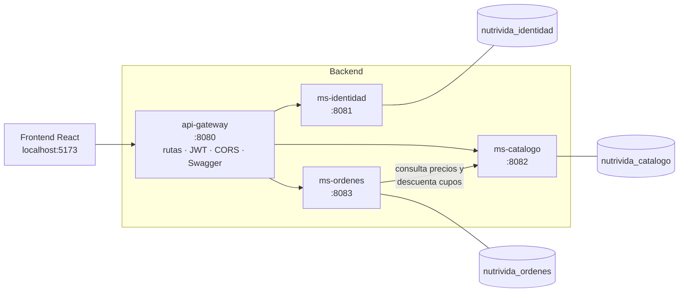

# NutriVida – Backend (microservicios)

Backend de **NutriVida**, plataforma de atención nutricional, desarrollado para la Evaluación Parcial 3 de **Desarrollo Fullstack II (DSY1104)**.

Arquitectura de **microservicios con Spring Boot**, autenticación con **JWT** (token de acceso + token de renovación), permisos por rol, documentación con **Swagger/OpenAPI** y rutas versionadas (`/api/v1`).

> Frontend del proyecto: [Anys-VS/NutriVida-React](https://github.com/Anys-VS/NutriVida-React)

---

## Arquitectura



| Servicio | Puerto | Base de datos | Responsabilidad |
|---|---|---|---|
| **api-gateway** | 8080 | — | Punto de entrada único. Enruta, valida el JWT (1ª capa de seguridad), centraliza CORS y une la documentación Swagger. |
| **ms-identidad** | 8081 | `nutrivida_identidad` | Registro de pacientes, login, emisión y renovación de JWT, cierre de sesión y CRUD de usuarios. |
| **ms-catalogo** | 8082 | `nutrivida_catalogo` | CRUD de categorías y servicios (consultas, planes, evaluaciones y talleres), precios con descuento y cupos. |
| **ms-ordenes** | 8083 | `nutrivida_ordenes` | Carrito de atenciones, pago simulado y órdenes. Se comunica con ms-catalogo por HTTP. |

**Seguridad en dos capas:** el gateway rechaza las peticiones sin token o con un token inválido o vencido. Cada microservicio vuelve a validar el token y aplica los permisos por rol (`@PreAuthorize`).

---

## Tecnologías

- Java 21 · Spring Boot 4.0.9 · Maven
- Spring Web MVC · Spring Data JPA (Hibernate 7) · Bean Validation
- Spring Security 7 + OAuth2 Resource Server (JWT HS256) · BCrypt
- Spring Cloud Gateway (WebFlux)
- springdoc-openapi 3.0.3 (Swagger UI)
- MySQL 8.4
- JUnit 5/6 · Mockito · AssertJ

---

## Requisitos

| Herramienta | Versión |
|---|---|
| JDK | 21 (Eclipse Temurin) |
| MySQL Server | 8.4 LTS, corriendo en `localhost:3306` |
| IDE | IntelliJ IDEA (recomendado; trae Maven integrado) |

Las bases de datos **se crean solas** al iniciar cada servicio (`createDatabaseIfNotExist=true`), y los datos de prueba se cargan automáticamente la primera vez.

---

## Configuración: variables de entorno

Las credenciales **no están en el código**. Cada servicio las lee desde variables de entorno:

| Variable | Obligatoria | Valor por defecto | Usada por |
|---|---|---|---|
| `DB_PASSWORD` | Sí | — | identidad, catálogo, órdenes |
| `JWT_SECRET` | Sí (mín. 32 caracteres, **igual en los 4 servicios**) | — | los 4 servicios |
| `DB_USER` | No | `root` | identidad, catálogo, órdenes |
| `DB_HOST` | No | `localhost` | identidad, catálogo, órdenes |
| `DB_PORT` | No | `3306` | identidad, catálogo, órdenes |
| `CATALOGO_URL` | No | `http://localhost:8082` | órdenes |

**En Windows (una sola vez, en cmd):**

```cmd
setx DB_PASSWORD "tu_clave_de_mysql"
setx JWT_SECRET "una-clave-secreta-de-al-menos-32-caracteres"
```

Después, **cierra y vuelve a abrir IntelliJ** para que tome las variables.

> Alternativa: en IntelliJ, `Run → Edit Configurations → Environment variables` de cada servicio.

---

## Cómo ejecutar

1. Verificar que el servicio **MySQL** esté en ejecución.
2. Abrir la carpeta `NutriVida-Backend` en IntelliJ. Si algún servicio no aparece en la pestaña Maven: clic derecho en su `pom.xml` → **Add as Maven Project**.
3. Ejecutar las 4 aplicaciones (en cualquier orden), por ejemplo desde la ventana **Services** (`Alt + 8`):
   - `MsIdentidadApplication`
   - `MsCatalogoApplication`
   - `MsOrdenesApplication`
   - `ApiGatewayApplication`

**Por línea de comandos** (desde la carpeta de cada servicio):

```bash
./mvnw spring-boot:run        # Linux / macOS
mvnw.cmd spring-boot:run      # Windows
```

---

## Documentación de la API (Swagger)

| Swagger | URL |
|---|---|
| **Unificado (recomendado)** | http://localhost:8080/swagger-ui.html — selector *Select a definition* para cada servicio |
| ms-identidad | http://localhost:8081/swagger-ui/index.html |
| ms-catalogo | http://localhost:8082/swagger-ui/index.html |
| ms-ordenes | http://localhost:8083/swagger-ui/index.html |

**Probar endpoints protegidos:** hacer login en `POST /api/v1/auth/login`, copiar el `accessToken`, presionar **Authorize** y pegarlo. El token dura **15 minutos**; para renovarlo se usa `POST /api/v1/auth/refresh` con el `refreshToken` (válido por 7 días y de un solo uso).

---

## Cuentas de prueba

| Rol | Correo | Contraseña |
|---|---|---|
| Administrador | `admin@gmail.com` | `admin123` |
| Recepción | `recepcion@gmail.com` | `recepcion` |
| Nutricionista | `carolina.fuentes@nutrivida.cl` | `nutri123` |
| Paciente | `paciente@gmail.com` | `paciente1` |

Otras nutricionistas: `rodrigo.sepulveda@`, `daniela.morales@` y `felipe.araya@nutrivida.cl` (contraseña `nutri123`).

**Pago simulado:** cualquier tarjeta de 16 dígitos con vencimiento futuro (ej. `4111111111111111`, `12/30`, CVV `123`). Las tarjetas que **terminan en `0000`** son rechazadas.

---

## Endpoints

Todas las rutas se consumen a través del gateway: `http://localhost:8080`.

### ms-identidad

| Método | Ruta | Acceso | Descripción |
|---|---|---|---|
| POST | `/api/v1/auth/registro` | Público | Registra un paciente y deja la sesión iniciada |
| POST | `/api/v1/auth/login` | Público | Devuelve `accessToken` y `refreshToken` |
| POST | `/api/v1/auth/refresh` | Público | Renueva los tokens (rotación) |
| POST | `/api/v1/auth/logout` | Público | Invalida el `refreshToken` |
| GET | `/api/v1/auth/me` | Con sesión | Datos del usuario de la sesión |
| GET | `/api/v1/usuarios?tipo=` | Administrador, Recepción | Lista usuarios (filtro opcional por tipo) |
| GET | `/api/v1/usuarios/{run}` | Administrador, Recepción o el propio usuario | Ver un usuario |
| POST | `/api/v1/usuarios` | Administrador | Crear usuario |
| PUT | `/api/v1/usuarios/{run}` | Administrador | Editar usuario |
| PATCH | `/api/v1/usuarios/{run}/estado` | Administrador | Activar / desactivar (cierra sus sesiones) |
| DELETE | `/api/v1/usuarios/{run}` | Administrador | Eliminar usuario |

### ms-catalogo

| Método | Ruta | Acceso | Descripción |
|---|---|---|---|
| GET | `/api/v1/categorias` | Público | Lista categorías |
| GET | `/api/v1/categorias/{id}` | Público | Ver una categoría |
| POST · PUT · DELETE | `/api/v1/categorias[/{id}]` | Administrador | Gestionar categorías |
| GET | `/api/v1/servicios?categoriaId=&soloActivos=` | Público | Lista servicios con precio final |
| GET | `/api/v1/servicios/{codigo}` | Público | Ver un servicio |
| POST · PUT · DELETE | `/api/v1/servicios[/{codigo}]` | Administrador | Gestionar servicios |
| PATCH | `/api/v1/servicios/{codigo}/cupos` | Con sesión | Descuenta cupos de un taller (lo usa ms-ordenes) |

### ms-ordenes

| Método | Ruta | Acceso | Descripción |
|---|---|---|---|
| GET | `/api/v1/carrito` | Paciente | Ver carrito y total |
| POST | `/api/v1/carrito/items` | Paciente | Agregar atención (servicio + fecha/hora) |
| DELETE | `/api/v1/carrito/items/{id}` | Paciente | Quitar atención |
| DELETE | `/api/v1/carrito` | Paciente | Vaciar carrito |
| POST | `/api/v1/carrito/checkout` | Paciente | Pagar (simulado) y generar la orden |
| GET | `/api/v1/ordenes` | Con sesión | Paciente: sus órdenes · Administrador y Recepción: todas |
| GET | `/api/v1/ordenes/{id}` | Dueño, Administrador o Recepción | Detalle de una orden |

---

## Reglas de negocio principales

**Identidad**
- RUN chileno válido (dígito verificador módulo 11); RUN y correo únicos.
- Contraseñas guardadas con BCrypt; nunca se devuelven en las respuestas.
- Un administrador no puede eliminarse ni desactivarse a sí mismo, y siempre debe quedar al menos un administrador activo.
- Desactivar un usuario cierra todas sus sesiones.

**Catálogo**
- Código de servicio con formato `AA000`, único. Precio mayor a 0 y descuento entre 0 y 100 %.
- Los talleres grupales requieren cupos y los planes requieren número de sesiones.
- No se puede eliminar una categoría con servicios asociados.
- La reserva de cupos bloquea la fila (bloqueo pesimista) para evitar sobreventa.

**Órdenes**
- Máximo 10 atenciones en el carrito y sin dos atenciones a la misma hora; fecha siempre futura.
- **El precio lo define ms-catalogo**, nunca el navegador.
- Al pagar se vuelve a verificar todo en el catálogo: si una atención ya no está disponible, **no se cobra nada**.
- Tarjeta validada (16 dígitos, MM/AA no vencido, CVV de 3 dígitos); solo se guardan los últimos 4 dígitos.
- Si ms-catalogo no responde, se informa con un error 503.

---

## Pruebas unitarias

Pruebas de las reglas de negocio con **JUnit + Mockito** (sin base de datos ni servicios levantados):

| Servicio | Clases de prueba | Pruebas |
|---|---|---|
| ms-identidad | `RunTest`, `UsuarioServiceTest` | 7 |
| ms-catalogo | `ServicioTest`, `ServicioServiceTest`, `CategoriaServiceTest` | 7 |
| ms-ordenes | `CarritoServiceTest`, `OrdenServiceTest` | 8 |

**Ejecutar:** en IntelliJ, clic derecho sobre `src/test/java` de cada servicio → **Run 'All Tests'**, o por consola:

```bash
mvnw.cmd test
```

---

## Estructura del repositorio

```
NutriVida-Backend/
├── api-gateway/      # Spring Cloud Gateway (WebFlux)
├── ms-identidad/     # Usuarios, login y JWT
├── ms-catalogo/      # Categorías y servicios
├── ms-ordenes/       # Carrito, pago y órdenes
└── README.md
```

Cada microservicio sigue la misma organización por capas:

```
src/main/java/cl/nutrivida/<servicio>/
├── config/        # Swagger, datos semilla
├── controller/    # Endpoints REST
├── dto/           # Datos de entrada y salida
├── exception/     # Errores de negocio y manejador global
├── model/         # Entidades JPA
├── repository/    # Acceso a datos (Spring Data)
├── security/      # Configuración JWT y permisos
└── service/       # Reglas de negocio
```

---

## Equipo

- _(completar con los nombres de los integrantes)_
